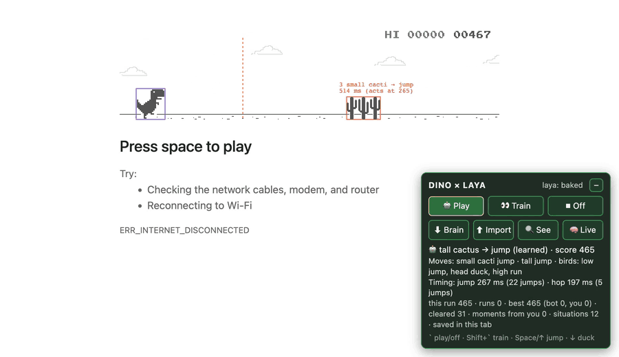

# Dinobot — Chrome Dino × Laya

A self-improving bot for Chrome's offline T-Rex game. Paste one file into the DevTools console and it plays the game, learns from every obstacle and crash, tunes its own jump timing, and can learn by watching you play.



▶ **[Full recording (MP4, 5 min)](media/dinobot-see-mode.mp4)** — headless Chrome 155, offline "No internet" page, fresh brain, no human input, 🔍 See mode on the whole time.

Starting from an empty brain, it scored **2,565** on its first run, crashed on a head-height bird at 2:27 ("ducked too late"), moved its duck timing for that bird from 320 to 365 ms, and was at 2,348 with no further crashes when the recording stopped. The GIF above is 0:38–0:58 of the same recording: jumping a low bird, ducking a head-height bird, running under a high bird, cactus jumps, and the switch to night mode.

The recording was made with Playwright driving headless Chrome: the page was taken offline, `dinobot.js` was run on the "No internet" page and the 🔍 See button clicked. Nothing else touched the game.

### What See mode shows

| On screen | Meaning |
|---|---|
| Purple box | The T-Rex's hit box (wider while ducking) |
| Coloured box | The next obstacle, coloured by the move the bot picked: **orange** jump · **yellow** hop · **blue** duck · **green** keep running · **red** not decided yet |
| Grey boxes | Other obstacles on screen |
| Dashed line | Where the obstacle's front edge will be when the bot acts |
| Label | Obstacle → move, milliseconds until it reaches the T-Rex, and the time at which the bot acts (`acts at 264`) |

## Quick start

1. Open Chrome and go to **`chrome://dino`** (or turn off Wi-Fi and open any page to get the "No internet" dinosaur).
2. Open the DevTools console: **⌥⌘J** on Mac, **Ctrl+Shift+J** on Windows/Linux.
3. Copy the whole of [`dinobot.js`](dinobot.js) and paste it into the console, then press **Enter**.
   - The first time you paste into DevTools, Chrome asks you to type `allow pasting` and press Enter. Do that, then paste again.
   - On a Mac you can copy the file straight from GitHub:
     ```sh
     curl -s https://raw.githubusercontent.com/johnpg82/dinobot/main/dinobot.js | pbcopy
     ```
4. The bot starts the game by itself and restarts it after every crash. Click once on the page (outside DevTools) so your own key presses reach the game when you want to take over or train it.
5. Click **🔍 See** in the panel to watch what it sees.

Pasting it again replaces the running copy, so you can update it without reloading.

## Controls

A small panel appears at the bottom right of the page. Drag it by its title; **–** folds it away.

| Button | Key | What it does |
|---|---|---|
| 🤖 Play | `` ` `` | The bot plays. It starts, resumes and restarts the game by itself. |
| 👀 Train | Shift + `` ` `` | You play. It records which move you use for each kind of obstacle and how you time your jumps. |
| ⏹ Off | | The bot does nothing. |
| ⬇ Brain | | Saves what it has learned as a `.json` file. On `chrome://dino` Chrome blocks downloads, so it copies the brain to the clipboard instead — paste it into a `.json` file to keep it. |
| ⬆ Import | | Loads a brain `.json`, either merged with what it already knows or replacing it. |
| 🔍 See | | Turns the overlay on and off. |
| 🧠 Live | | Runs the Laya model live instead of its baked-in answers (see below). |

**Taking over mid-run:** in Play mode, press Space, ↑ or ↓ and you have control for 1.5 seconds after your last key press. It learns from what you do and then takes back over.

The panel's status lines show the current decision and score, the move it has settled on for each kind of obstacle, its learned jump timing, and run stats (best score, runs, obstacles cleared, situations seen).

## How it works

For each obstacle, about half a second before it arrives, the bot picks one of four moves — **jump**, **hop** (a short jump), **duck**, or **keep running** — and then presses the keys at the right moment.

- **Laya (System 1).** [Laya](https://huggingface.co/receptron/laya-onnx) is an open-source, Jev-compatible model (Apache-2.0). It was asked the same question about every kind of obstacle: *"Which move gets it past the next obstacle?"* Its answers are baked into the file, because the dino page blocks the web workers and storage needed to run a 1.7 GB model.
- **Physics (System 2).** A table of which moves the game's collision boxes allow at all (worked out offline with the game's own jump physics) is multiplied into Laya's answers, so it never starts out ducking into a cactus. A look-ahead with the same physics decides when it's safe to drop early after a jump.
- **Learning from experience.** Every situation — obstacle type × game speed (slow / medium / fast) × whether another obstacle follows right behind — keeps a running score for each move. Clearing an obstacle counts as a win; every crash is diagnosed ("jumped too early", "hop too low for it", "still in the air from the last obstacle", …) and scored. Early on Laya's answer carries most weight; experience takes over as it piles up.
- **Self-tuning timing.** Each move has its own trigger time per obstacle and speed. After a crash it shifts the trigger past the press that failed; after every clean jump it compares the clearance under the T-Rex's feet on the way in and on the way out and evens them up.
- **Learning from you.** In 👀 Train mode (or whenever you take over), it records your moves as demonstrations. These count most while the bot has little experience of its own.
- **Memory.** The brain is saved in `localStorage` where the page allows it. `chrome://dino` doesn't, so there it lives in `window.name`, which survives reloading the tab but not closing it — use **⬇ Brain** to keep it.

### Running Laya live

**🧠 Live** loads the full Laya model (~1.7 GB, cached by the browser after the first download) into a web worker with [onnxruntime-web](https://www.npmjs.com/package/onnxruntime-web) on WebGPU (falling back to WASM) and re-asks it about every kind of obstacle. This only works on normal `https://` pages that host a copy of the game; `chrome://dino` and the offline page block web workers, so there it stays on the baked answers.

## Console API

Everything is on `window.__dinoBot`:

```js
__dinoBot.setMode('bot')           // 'bot' | 'train' | 'off'
__dinoBot.debug(true)              // See overlay on/off
__dinoBot.stats()                  // one-line summary
__dinoBot.policy()                 // the move it would pick in every situation
__dinoBot.timing()                 // learned trigger times
__dinoBot.exportBrain()            // download / copy the brain, also returns it as JSON text
__dinoBot.importBrain(json, 'merge') // or 'replace'
__dinoBot.forgetDemos()            // forget what it learned from watching you
__dinoBot.reset()                  // start from an empty brain
__dinoBot.laya()                   // start Laya live
__dinoBot.uninstall()              // remove the bot and its panel

__dinoBot.LOG.decisions = true     // log every decision and update
__dinoBot.CFG.epsilon = 0          // settings, e.g. no exploration
```

Set `window.__DINOBOT_START_OFF = true` before pasting to install it switched off.

Useful settings in `__dinoBot.CFG`:

| Setting | Default | Meaning |
|---|---|---|
| `yieldToHumanMs` | 1500 | How long you keep control after pressing a key in Play mode |
| `autoStart` | true | Start, resume and restart the game automatically |
| `fastDrop` | true | Press ↓ after clearing an obstacle to land sooner |
| `decideAtMs` | 520 | Pick a move when the obstacle is this many ms away |
| `epsilon` | 0.03 | Chance of trying another plausible move |
| `priorHalfLife` | 4 | Encounters until Laya's answer counts half as much as experience |
| `demoHalfLife` | 12 | Own encounters until your demonstrations count half as much |

## Compatibility

Tested on Chrome 155 (macOS), on both `chrome://dino` and the offline "No internet" page. It finds the game through `Runner.getInstance()` in current Chrome builds and `Runner.instance_` in older builds and copies of the game. It keeps the panel readable when the game switches to night mode.

## Credits

- The T-Rex game is part of Chromium (© The Chromium Authors). It is not included here — the bot drives the copy built into Chrome.
- Laya model: [receptron/laya-onnx](https://huggingface.co/receptron/laya-onnx), Apache-2.0.
